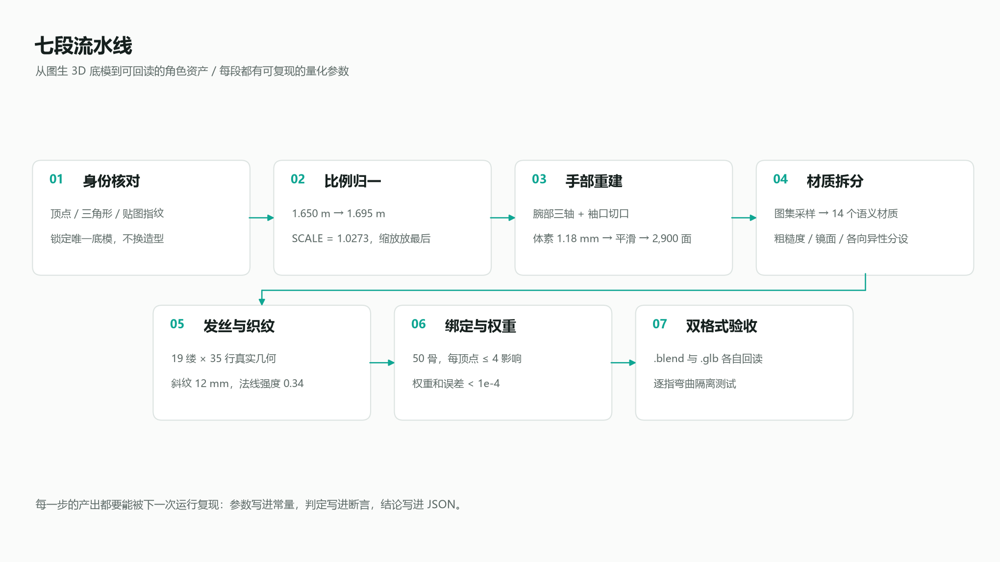
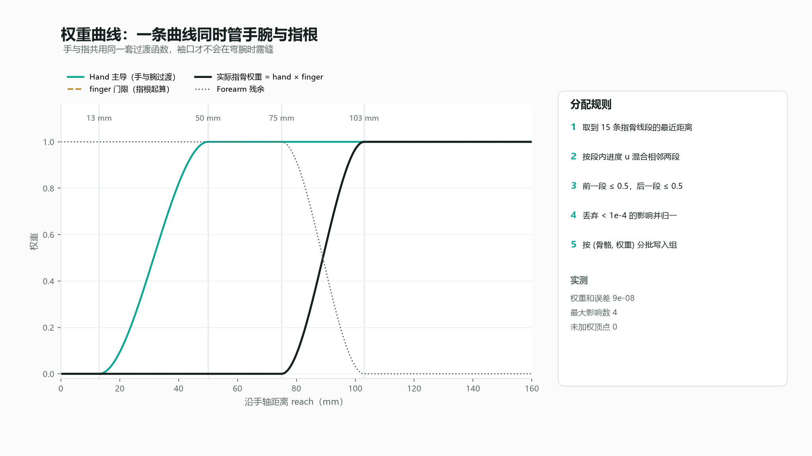
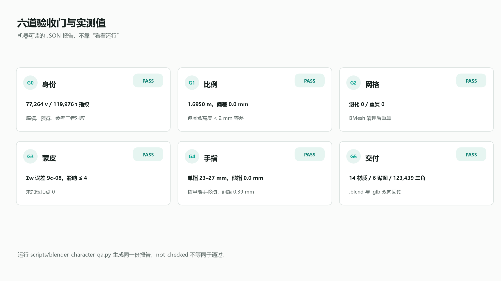

# realistic-character-from-multiview

**把「图生 3D 角色」修成能进引擎的资产 —— 一套可复现的量化工艺，不是一个模型的截图。**


一个 WorkBuddy / Claude 技能包：当底模来自 AI 多视图重建、整体尚可但手、头发、衣料不能看时，按七段流水线把它改成可绑定、可回读、可交付的角色资产。

> 本仓库只包含方法、参数和检查脚本，**不包含任何角色模型、贴图或渲染图**。文中所有数值来自一次真实交付，可直接复现。

---

## 目录

- [它解决什么](#它解决什么)
- [七段流水线](#七段流水线)
- [三个关键参数](#三个关键参数)
- [验收门](#验收门)
- [快速开始](#快速开始)
- [实测数据](#实测数据)
- [常见失败与对策](#常见失败与对策)
- [仓库结构](#仓库结构)
- [边界与已知限制](#边界与已知限制)
- [许可](#许可)

---

## 它解决什么

图生 3D 给的是**造型底子 + 一张烘好的 UV 图集**。它不给你：

- 正确的拓扑（指缝常常是糊死的）
- 可用的绑定（骨架为空，或只有躯干）
- 材质语义（一个 Principled 材质管全身，所以看起来像塑料）

于是出现典型症状：手指黏成一坨、发顶一片银亮、整身发白、裙面串进别处的花纹。

这个技能的做法很直接：**该重做的重做，该量化的量化**。比例归一、双手重建、材质拆分、指骨绑定、双格式回读，每一步都留一个能被下一次运行复现的数值或断言。

## 七段流水线



| 阶段 | 产出 | 关键判据 |
|---|---|---|
| 01 身份核对 | 锁定唯一底模 | 顶点 / 三角形 / 贴图指纹一致 |
| 02 比例归一 | 统一到项目身高 | `SCALE = 目标身高 / 参考身高`，缩放放最后 |
| 03 手部重建 | 腕部三轴 + 五指 | 袖口切口约 120 条边 |
| 04 材质拆分 | 14 个语义材质 | 图集采样 + 位置约束 |
| 05 发丝与织纹 | 真实发缕几何 | 19 缕 × 35 行，斜纹 12 mm |
| 06 绑定与权重 | 50 骨，每顶点 ≤ 4 影响 | 权重和误差 < 1e-4 |
| 07 双格式验收 | `.blend` + `.glb` | 三角形数一致，逐指隔离通过 |

## 三个关键参数

### 1. 腕部三轴：手不是轴对齐的


用世界 XYZ 做放样，手指会朝错误方向长。从袖口截面反推三轴后，五指弯曲方向、指甲朝向、袖口切口会自动一致；左右手共用一套代码，只镜像 `span`。

```
origin   (±0.468, −0.036,  0.969)
axis     (±0.690, −0.230, −0.686)   # 前臂 → 指尖
dorsal   front 对 axis 的正交分量     # 手背法向
span     sign × (axis × dorsal)      # 掌心横向
cuff_cut 0.010 m                     # 沿 axis 后退
```

### 2. 权重：一条曲线同时管手腕与指根



```
hand    = smoothstep((reach − 13) / 37)
finger  = smoothstep((reach − 75) / 28)
w_finger = hand × finger
```

袖口、手、前臂共用同一个 `hand` 曲线，所以弯腕时不会露缝。每顶点最多 4 个影响，段内再按进度混合相邻指节，丢弃小于 `1e-4` 的权重后归一。

### 3. 融合顺序：融合 → 平滑 → 减面

体素 `1.18 mm` 融合掌指，平滑 5 次（factor 0.58），再减到约 2,900 面。顺序换一下，指根就会裂开，之后补不回来。

## 验收门



| 门 | 判据 | 不通过时 |
|---|---|---|
| G0 身份 | 底模、预览、参考三者对应 | 停下来问清楚，不要猜 |
| G1 比例 | 包围盒高度与目标差 < 2 mm | 回第二步重算缩放 |
| G2 网格 | 退化面 0、重复面 0、无 NaN | 清 BMesh、重算法线 |
| G3 蒙皮 | 权重和误差 < 1e-4、影响 ≤ 4 | 修分配，不要整体平滑糊过去 |
| G4 手指 | 单指弯曲时其他指尖位移 ≈ 0 | 查最近段判定与过渡区间 |
| G5 交付 | 两种格式回读，三角形数一致 | 重新导出，不要只报“已导出” |

## 快速开始

### 作为技能安装

```bash
git clone https://github.com/DENGHEZI/realistic-character-from-multiview.git \
  ~/.workbuddy/skills/realistic-character-from-multiview
```

重开会话后即可用 `@skill:realistic-character-from-multiview` 调用。技能内含分阶段做法与手部工艺两份参考，按需读取，不占常驻上下文。

### 只跑检查脚本

任意一份带骨架的 `.blend` 或 `.glb` 都能验：

```bash
blender -b --factory-startup --python scripts/blender_character_qa.py -- \
  --file "your_character.glb" --report qa.json --height 1.695
```

输出示例（节选）：

```json
{
  "status": "pass",
  "gates": {
    "triangles": 123439,
    "materials": 14,
    "bones": 50,
    "degenerate_triangles": 0,
    "duplicate_triangles": 0,
    "max_influences": 4,
    "maximum_weight_sum_error": 9e-08
  },
  "finger_pose": {
    "status": "pass",
    "per_bone": {
      "Index.03.L": { "tip_median_mm": 23.364, "other_tips_max_mm": 0.0 }
    }
  }
}
```

- `.blend` 直接打开；`.glb` / `.gltf` / `.fbx` 导入空场景。
- 检测到 `<Digit>.03.<L|R>` 命名时自动跑逐指隔离测试，否则标 `not_applicable`。
- 退出码 0 表示全部通过，1 表示有失败项；`not_checked` 不等于通过。

## 实测数据

同一份角色，分别在 Blender 工程与 GLB 回读上各跑一遍：

| 指标 | Blender | GLB 回读 |
|---|---:|---:|
| 顶点 | 62,580 | 83,065 |
| 三角形 | 123,439 | 123,439 |
| 材质 | 14 | 14 |
| 骨骼 | 50 | 50 |
| 身高 | 1.6950 m | 1.6950 m |
| 权重和误差 | 9e-08 | 9e-08 |
| 退化 / 重复三角 | 0 / 0 | 0 / 0 |
| 单指弯曲位移 | 23–27 mm | 23–27 mm |
| 其他指尖位移 | 0.0 mm | 0.0 mm |
| 指甲到皮肤间距（p95） | 0.388 mm | 0.392 mm |

顶点数不同是正常的：GLB 按 UV / 法线接缝拆顶点，三角形数必须一致。

## 常见失败与对策

| 现象 | 真实原因 | 处理 |
|---|---|---|
| 整体发白、发粉 | 曝光过高 + 单一高镜面材质 | 先降曝光对齐原版，再按部位拆材质 |
| 手指黏成一坨 | 底模指缝本来就闭合 | 重做手，别靠减面分开 |
| 指根出现裂缝 | 融合后没平滑就减面 | 融合 → 平滑 → 减面 |
| 发顶一片银亮 | 各向异性叠加强法线 | 降法线强度，改用方向纹理 |
| 裙面串进别处花纹 | 多部件共用一个图集 UV 岛 | 该部件换独立贴图，别在原图集上擦 |
| 弯指时袖口露缝 | 手腕与袖口权重区间不一致 | 共用同一条过渡函数 |

其中两条属于“改材质解决不了”的问题：串色和图集错位。遇到就换贴图，不要试图在原图上修补。

## 仓库结构

```
.
├── SKILL.md                        # 技能入口：流程、方法、验收门
├── references/
│   ├── pipeline.md                 # 分阶段参数、图集采样、UV、灯光、导出
│   └── hand-rig.md                 # 三轴、放样、体素、指甲、权重、姿态阈值
├── scripts/
│   └── blender_character_qa.py     # 网格 / 权重 / 贴图 / 指骨隔离测试
└── assets/                         # 参数示意图（非模型渲染）
```

## 边界与已知限制

- **不生成底模。** 造型上限由底模决定，本技能只做精修与验收。
- **只验证到 glTF 与 Blender。** 目标引擎（Unity / Unreal / Godot）未实测时，不得声称“引擎通过”。
- **检查脚本依赖 Blender。** 需 Blender 3.6+，在 5.3 实测；更低版本未验证。
- **合规不由脚本判断。** 底模若来自第三方平台，商用前须自行确认当次授权条款；免费额度不等于可商用。
- **写实不等于像本人。** 面部相似度受底模与参考图限制，本仓库不提供身份还原保证。

## 许可

代码与文档采用 [MIT License](LICENSE)。仓库内不含任何第三方模型、贴图或角色肖像。

---

如果这套流程帮你省下了一轮返工，点个 Star 让更多人少踩一次“手指黏成一坨”的坑。
