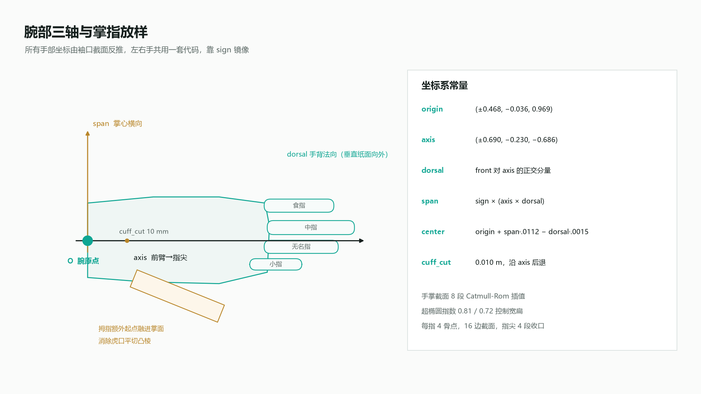
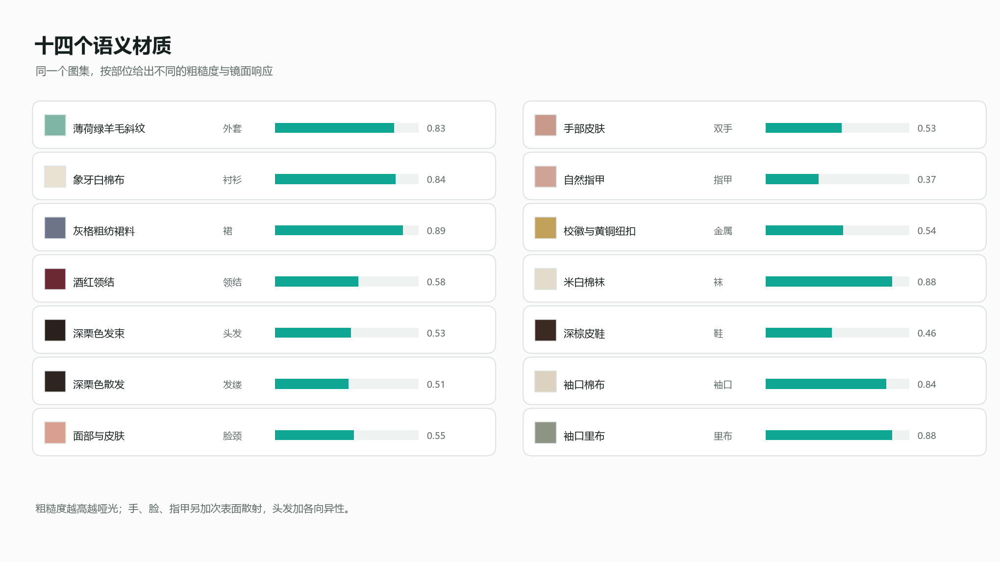
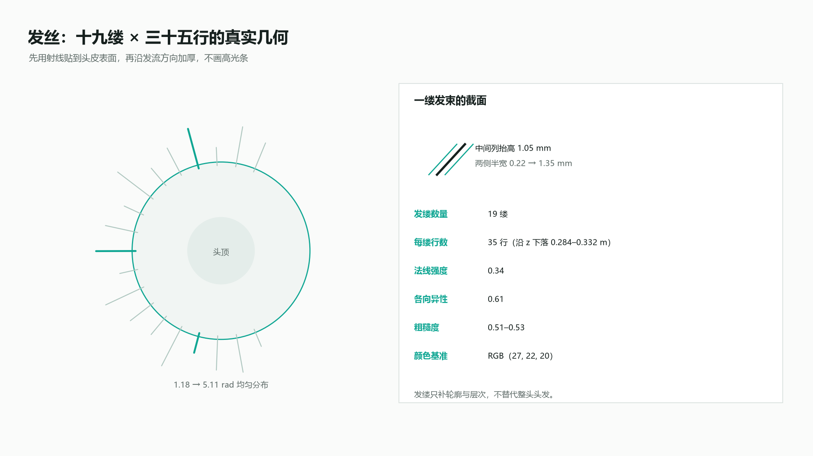
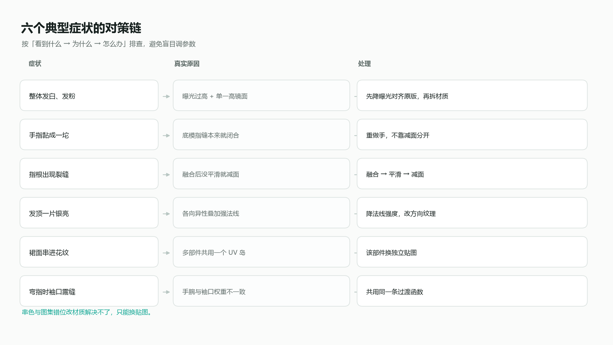
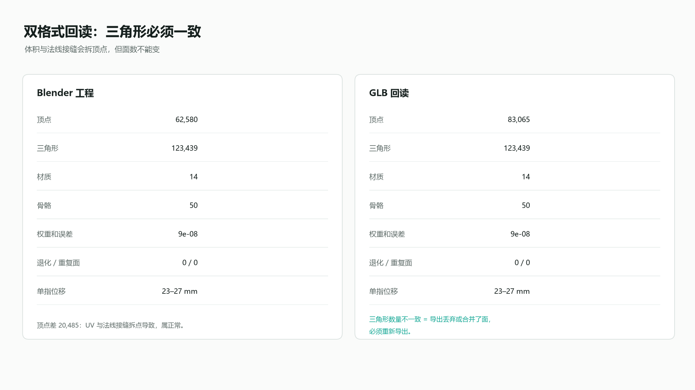
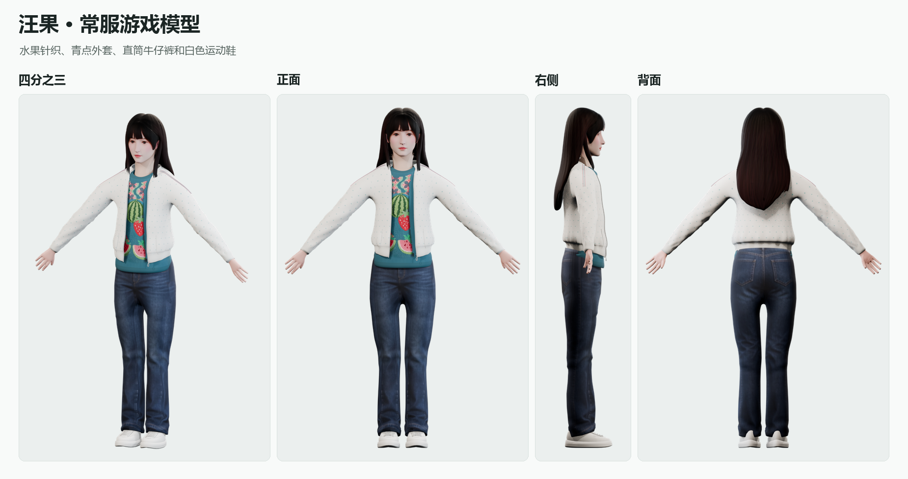
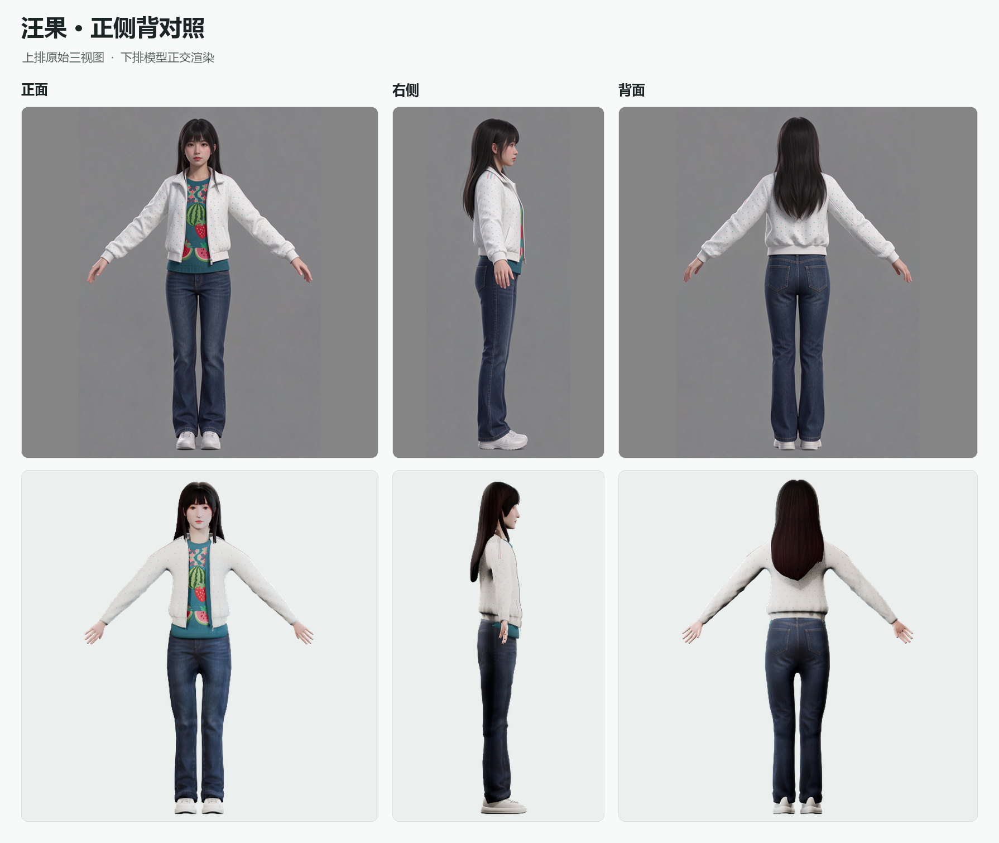
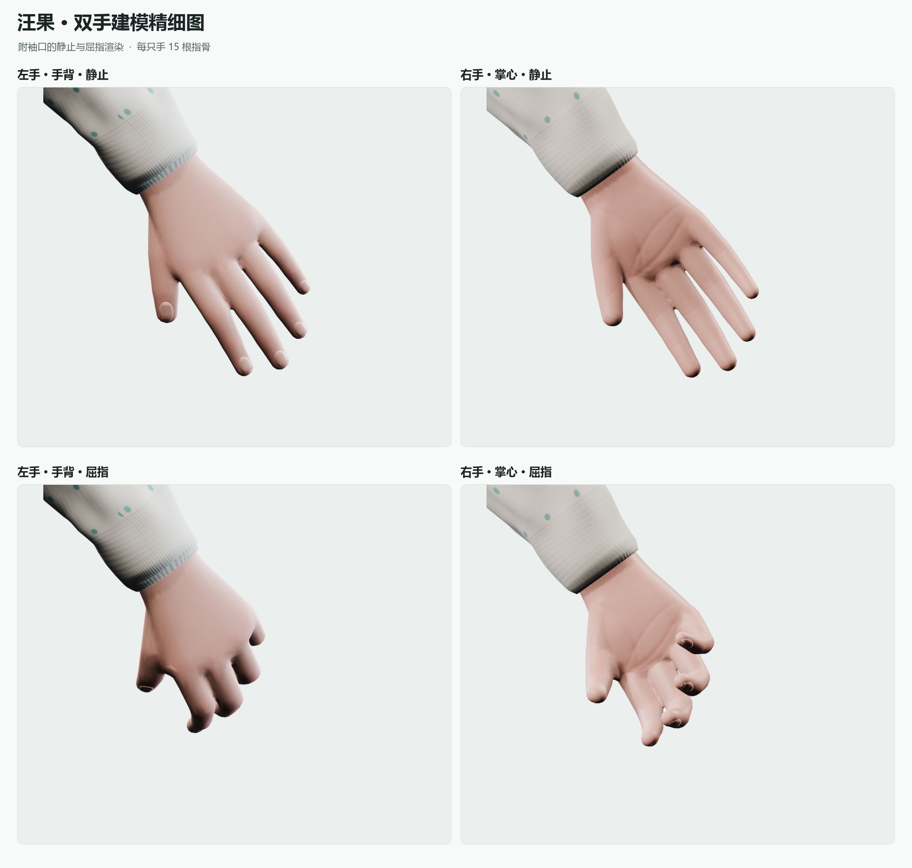
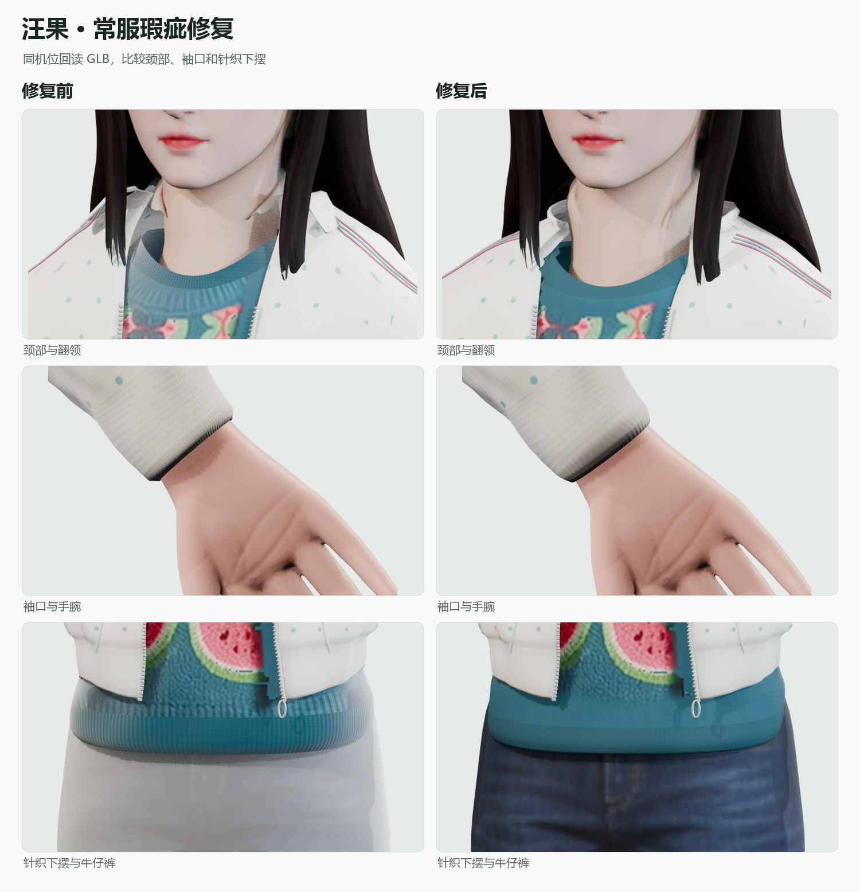
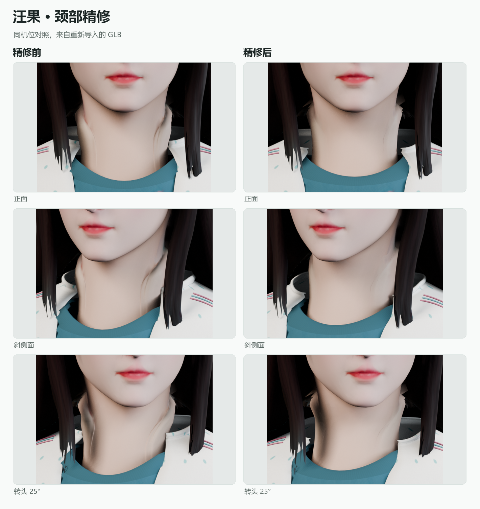

<h1 align="center">写实角色精修图谱</h1>

<p align="center"><sub>realistic-character-from-multiview</sub></p>

<p align="center">把 AI 图生 3D 的角色底模，修成可绑定、可回读、可交付的资产。<br>八张图谱，一套能复现的工艺。</p>

<p align="center">
  <a href="https://github.com/DENGHEZI/realistic-character-from-multiview/actions/workflows/ci.yml"></a>
  
  
  
  
</p>

<p align="center">
  <a href="#交付样本">样本</a> ·
  <a href="#图谱总览">图谱</a> ·
  <a href="#快速开始">快速开始</a> ·
  <a href="#实测数据">实测数据</a> ·
  <a href="#边界与已知限制">边界</a> ·
  <a href="#许可">许可</a>
</p>

> 方法与参数来自一次真实交付，另有 5 张实拍样本图佐证结果。**不含可编辑工程或模型文件**，数值可复现。

## 图谱总览

<table>
<tr>
<td width="50%" align="center" valign="top">
  <a href="assets/pipeline.png"></a><br>
  <b>七段流水线</b><br>
  <sub>从身份核对到双格式验收，每段一个判据</sub>
</td>
<td width="50%" align="center" valign="top">
  <a href="assets/hand-frame.png"></a><br>
  <b>腕部三轴</b><br>
  <sub>手不是轴对齐的，坐标由袖口截面反推</sub>
</td>
</tr>
<tr>
<td width="50%" align="center" valign="top">
  <a href="assets/weights.png"></a><br>
  <b>权重曲线</b><br>
  <sub>一条曲线同时管手腕与指根，弯腕不露缝</sub>
</td>
<td width="50%" align="center" valign="top">
  <a href="assets/materials.png"></a><br>
  <b>十四个语义材质</b><br>
  <sub>同一个图集，按部位给不同粗糙度与镜面</sub>
</td>
</tr>
<tr>
<td width="50%" align="center" valign="top">
  <a href="assets/hair.png"></a><br>
  <b>发丝几何</b><br>
  <sub>十九缕 × 三十五行的真实发束，不画高光条</sub>
</td>
<td width="50%" align="center" valign="top">
  <a href="assets/symptoms.png"></a><br>
  <b>症状对策链</b><br>
  <sub>看到什么 → 为什么 → 怎么办，避免盲调参数</sub>
</td>
</tr>
<tr>
<td width="50%" align="center" valign="top">
  <a href="assets/gates.png"></a><br>
  <b>六道验收门</b><br>
  <sub>机器可读的 JSON，不靠「看着还行」</sub>
</td>
<td width="50%" align="center" valign="top">
  <a href="assets/export.png"></a><br>
  <b>双格式回读</b><br>
  <sub>顶点可以拆，三角形数必须一致</sub>
</td>
</tr>
</table>

## 交付样本

同一角色的实际渲染与修复前后对照，均来自本地 Blender 与 GLB 回读。

<table>
<tr>
<td width="50%" align="center" valign="top">
  <a href="assets/samples/full-body.png"></a><br>
  <b>全身样本</b><br>
  <sub>常服换装后的整体渲染</sub>
</td>
<td width="50%" align="center" valign="top">
  <a href="assets/samples/three-views.png"></a><br>
  <b>三视对照</b><br>
  <sub>正侧背同机位核对轮廓</sub>
</td>
</tr>
<tr>
<td width="50%" align="center" valign="top">
  <a href="assets/samples/hands.png"></a><br>
  <b>双手精细</b><br>
  <sub>十指逐指重建与甲片贴合</sub>
</td>
<td width="50%" align="center" valign="top">
  <a href="assets/samples/repair-before-after.png"></a><br>
  <b>瑕疵修复对照</b><br>
  <sub>同机位同光照的修前修后</sub>
</td>
</tr>
<tr>
<td width="100%" align="center" valign="top">
  <a href="assets/samples/neck-before-after.png"></a><br>
  <b>颈部精修对照</b><br>
  <sub>颈宽 106 → 99 mm，七姿态跨部件相交均为 0</sub>
</td>
</tr>
</table>

## 快速开始

**装成技能**

```bash
git clone https://github.com/DENGHEZI/realistic-character-from-multiview.git \
  ~/.workbuddy/skills/realistic-character-from-multiview
```

重开会话后用 `@skill:realistic-character-from-multiview` 调用。技能内含分阶段做法与手部工艺两份参考，按需读取，不占常驻上下文。

**只跑检查**

```bash
blender -b --factory-startup --python scripts/blender_character_qa.py -- \
  --file "character.glb" --report qa.json --height 1.695
```

<details>
<summary>输出示例</summary>

```json
{
  "status": "pass",
  "gates": {
    "triangles": 123439,
    "materials": 14,
    "bones": 50,
    "degenerate_triangles": 0,
    "duplicate_triangles": 0,
    "max_influences": 4,
    "maximum_weight_sum_error": 9e-08
  },
  "finger_pose": {
    "status": "pass",
    "per_bone": {
      "Index.03.L": { "tip_median_mm": 23.364, "other_tips_max_mm": 0.0 }
    }
  }
}
```

</details>

`.blend` 直接打开；`.glb` / `.gltf` / `.fbx` 导入空场景。检测到 `<Digit>.03.<L|R>` 命名时自动跑逐指隔离测试，否则标 `not_applicable`。退出码 `0` 表示通过，`1` 表示有失败项。

## 实测数据

同一份角色，在 Blender 工程与 GLB 回读上各跑一遍：

| 指标 | Blender | GLB 回读 |
|---|---:|---:|
| 顶点 | 62,580 | 83,065 |
| 三角形 | 123,439 | 123,439 |
| 材质 / 骨骼 | 14 / 50 | 14 / 50 |
| 身高 | 1.6950 m | 1.6950 m |
| 权重和误差 | 9e-08 | 9e-08 |
| 退化 / 重复三角 | 0 / 0 | 0 / 0 |
| 单指弯曲位移 | 23–27 mm | 23–27 mm |
| 其他指尖位移 | 0.0 mm | 0.0 mm |
| 指甲到皮肤间距（p95） | 0.388 mm | 0.392 mm |

## 仓库结构

```
.
├── SKILL.md                        # 技能入口：流程、方法、验收门
├── references/
│   ├── pipeline.md                 # 分阶段参数、图集采样、UV、灯光、导出
│   └── hand-rig.md                 # 三轴、放样、体素、指甲、权重、姿态阈值
├── scripts/
│   ├── blender_character_qa.py     # 网格 / 权重 / 贴图 / 指骨隔离测试
│   └── blender_neck_qa.py          # 颈部 / 领口七姿态自交检查
├── assets/
│   ├── *.png                       # 八张参数图谱（非模型渲染）
│   └── samples/                    # 五张交付样本图（角色渲染）
└── .github/workflows/ci.yml        # 语法、技能元数据与资源引用校验
```

## 边界与已知限制

- **不生成底模。** 造型上限由底模决定，本技能只做精修与验收。
- **只验证到 glTF 与 Blender。** 目标引擎（Unity / Unreal / Godot）未实测时，不得声称「引擎通过」。
- **检查脚本依赖 Blender。** 需 3.6+，在 5.3 实测；CI 只做静态校验，不跑 Blender。
- **合规不由脚本判断。** 底模若来自第三方平台，商用前须自行确认当次授权条款；免费额度不等于可商用。

## 许可

代码与文档采用 [MIT License](LICENSE)。仓库内不含任何第三方模型或贴图；`samples/` 中的角色渲染为案例交付样本，不代表可商用授权。

---

<p align="center"><sub>帮你省下一轮返工的话，点个 Star。</sub></p>
